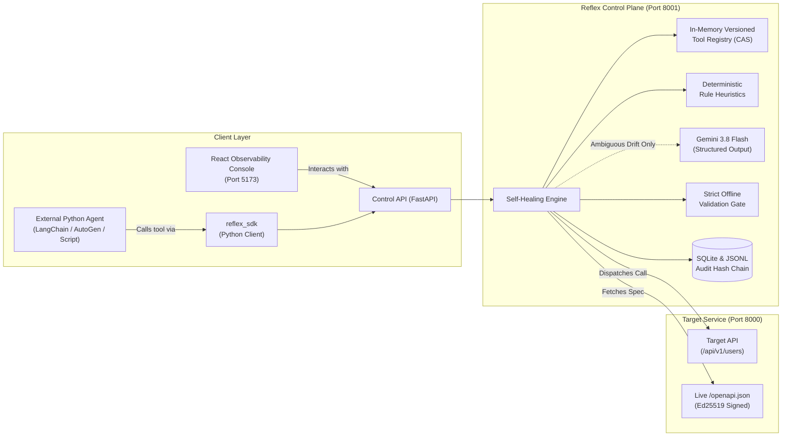

# Reflex — Complete Project & Feature Guide

> **A Presentation-Ready Explainer for Evaluators, Engineers, and Judges**

---

## 1. The Elevator Pitch: What is Reflex?

Imagine you build an AI agent using LangChain, CrewAI, AutoGen, or custom Python code. Your agent calls an external API using a tool definition like:
```json
{ "user_id": "123" }
```
One morning, the external API team ships an update. Without warning:
* `user_id` is renamed to `uid`.
* The parameter type changes from a `string` to an `integer`.
* The field is moved inside a nested object: `{"target": {"id": 123}}`.
* A new mandatory security header `X-Tenant-Token` is now required.

### What happens to traditional agents?
Traditional agents receive an **HTTP 422 Unprocessable Entity** error. They either:
1. Crash immediately.
2. Blindly retry the exact same failing payload 3 to 5 times, draining your token budget.
3. Hallucinate bogus values or invent fake credentials in desperation.

### How Reflex Solves This
**Reflex is a self-healing tool registry and resilience layer.** It sits directly between the AI agent and external APIs. When an API contract breaks at runtime, Reflex:
1. Intercepts the failure.
2. Downloads the live, authoritative `/openapi.json` contract from the server.
3. Computes a structural diff between the old and new schemas.
4. Generates a validated adapter in memory (using fast deterministic rules, with a bounded Gemini LLM fallback).
5. Hot-patches the tool definition via Compare-And-Swap (CAS) in memory (**zero service restarts**).
6. Retries the tool call and delivers the successful result back to the agent in milliseconds.
7. **Refuses safely** if a change cannot be proved correct (e.g., lossy data conversion or missing required information).

---

## 2. System Architecture at a Glance

Reflex operates across three local services:



---

## 3. Complete Feature Catalog (Explained Page by Page)

Every page in the Reflex Console represents a vital capability in runtime API resilience.

---

### Feature 1: Live System Mission Control (`/console`)
* **What the user sees:** The Dashboard displaying active service health LEDs, active schema version ($v1, v2$), active SHA-256 contract hash, and four primary Key Performance Indicators (KPIs):
  * **Adaptation Rate (ZTAR):** Percentage of breaking changes healed without human intervention.
  * **Median MTTR:** Mean time to recover (typically $< 400\text{ms}$).
  * **Token Overhead:** Token cost incurred during repair (0 tokens for rule repairs).
  * **Correct Refusals:** Number of unsafe repairs correctly blocked.
* **Why it matters:** Proves that all metrics are live and real. When no runs have occurred, Reflex displays clean em dashes (`—`) rather than synthetic 99% claims.

---

### Feature 2: Chaos & Schema Mutation Studio (`/console/schema`)
* **What the user does:** The user can simulate real-world API drift on demand. They select a mutation type and error style and click **Apply mutation**:
  * `M_RENAME`: Field rename (`user_id` $\rightarrow$ `uid`).
  * `M_TYPE`: Type transformation (string to integer).
  * `M_NEST`: Structural hierarchy nesting (`user_id` $\rightarrow$ `target.id`).
  * `M_HEADER`: New mandatory auth header (`X-Tenant-Token`).
  * `ps_demo`: Multi-mutation combination (renaming + typing + nesting + headers).
  * **Error Styles:** `clear` (detailed 422), `vague` (opaque 400), or `none` (silent 400).
* **What Reflex does behind the scenes:** Mutates the live Target API in memory, increments the schema version, regenerates `/openapi.json`, and runs an internal consistency check to confirm the contract matches server validators.
* **Why it matters:** Gives evaluators an interactive sandbox to test breaking API changes in real time.

---

### Feature 3: The Duel Arena — Baseline vs. Reflex (`/console/compare`)
* **What the user does:** Selects a breaking drift scenario (e.g., `ps_demo`) and clicks **Run comparison**.
* **What Reflex does:** Runs two identical agents concurrently against the drifted API:
  * **Left Lane (Baseline Agent):** A standard tool-calling agent with a frozen schema. It calls the API $\rightarrow$ receives HTTP 422 $\rightarrow$ retries the exact same invalid payload 3 times $\rightarrow$ crashes with **FAILED**.
  * **Right Lane (Reflex Healer):** Intercepts HTTP 422 $\rightarrow$ downloads `/openapi.json` $\rightarrow$ AST diff $\rightarrow$ synthesizes adapter $\rightarrow$ validates against schema $\rightarrow$ hot-patches in-memory registry $\rightarrow$ retries $\rightarrow$ finishes with **HEALED**.
* **What the user sees:** A live, side-by-side animated execution feed with millisecond markers, payload previews, and visual suture stitches indicating recovery.

---

### Feature 4: Real-World Public API Benchmark (`/console/real-world`)
* **What the user sees:** A benchmark matrix testing Reflex against real, versioned public API contracts (such as GitHub REST API issues endpoints).
* **What Reflex does:** Evaluates breaking contract shifts from vendored OpenAPI specifications (`specs/github/old.json` vs. `new.json`), ensuring Reflex works on messy, multi-property public APIs, not just synthetic demos.
* **Why it matters:** Proves the engine generalizability beyond lab-created test cases.

---

### Feature 5: Scientific Evaluation & Confidence Splits (`/console/evaluation`)
* **What the user sees:** Performance breakdowns partitioned into **Tuning**, **Held-out**, and **Fuzz** splits, accompanied by **95% Wilson score confidence intervals** (e.g., `95% CI 85.2%–97.8%`).
* **Reproducibility CLI:** Displays exact copy-paste terminal commands to replay any generated fuzz seed (e.g., `python -m app.runner.run_suite --replay-seed 700004`).
* **Why it matters:** Demonstrates scientific rigor. Evaluators can confirm Reflex avoids overfitting to known cases.

---

### Feature 6: Forensic Trace Inspector (`/console/trace`)
* **What the user does:** Selects any historical or live run ID to replay the execution timeline.
* **What the user sees:** Step-by-step event cards showing:
  `tool_call_start` $\rightarrow$ `http_error (422)` $\rightarrow$ `drift_classified` $\rightarrow$ `schema_fetched` $\rightarrow$ `schema_diff` $\rightarrow$ `candidate_patch` $\rightarrow$ `patch_validated` $\rightarrow$ `registry_updated` $\rightarrow$ `retry_success`.
* **Deep Inspection:** Expanding each card shows the raw JSON before/after, headers sent, latency deltas, and token counts.

---

### Feature 7: Cryptographic Compliance Audit Ledger (`/console/audit`)
* **What the user sees:** An append-only audit trail recording every patch, safe refusal, and rollback.
* **Key Columns:** Timestamp, Tool Name, Outcome badge, Schema Version Shift ($v1 \rightarrow v2$), Schema SHA-256 hash, Confidence Score, **Repair Path** (`Rule` vs. `LLM`), and Reason Code.
* **Expandable Diff:** Clicking an entry reveals the side-by-side old vs. new tool definitions and supporting evidence.
* **Why it matters:** In enterprise environments, AI agents modifying tools dynamically is a governance risk. Reflex guarantees a non-repudiable audit trail of every automated repair.

---

### Feature 8: Parity Scorecard & Benchmark Results (`/console/results`)
* **What the user sees:** Formal scientific comparison table between Baseline and Reflex across 9 standard metrics:
  * Total cases, Recovered count, Adaptation Rate (ZTAR), Correct Refusal Rate, Wrong Patches, Median MTTR, p95 MTTR, Token Consumption, and Execution Time Ratio.
  * Baseline failures are explicitly reported as **Failed (no recovery)**.
  * Interactive latency strip plot visualizing recovery times against the 4.0-second Problem Statement ceiling.

---

### Feature 9: Principled Safety Refusal Engine (`/console/safety`)
* **What the user does:** Selects any non-recoverable failure scenario and clicks **Execute scenario**:
  1. **Lossy Type Conversion:** Converting a float to an integer where decimals would be truncated.
  2. **Ambiguous Mapping:** Two new fields appear with identical token similarity (e.g., `billing_id` vs. `shipping_id`).
  3. **Missing Mandatory Field:** A new required field is introduced with no available value or source.
  4. **Missing Credential:** A new security header is required with no secret configured in the vault.
  5. **500 Server Outage:** An upstream infrastructure crash (classified as non-drift).
  6. **Tampered Contract:** An untrusted, unsigned schema is served.
* **What Reflex does:** Instead of guessing or hallucinating default values, Reflex halts immediately, preserves data integrity, and returns a structured reason code (e.g., `REFUSE:LOSSY_CONVERSION`).
* **Why it matters:** Proves that **principled refusal is as critical as self-healing**. Reflex will never corrupt enterprise databases.

---

### Feature 10: Ed25519 Security & Provenance (`/console/security`)
* **What the user does:**
  * **Verify Chain Button:** Runs cryptographic verification across the audit ledger to confirm that no historical record has been modified ($H_i = \text{SHA256}(H_{i-1} \parallel \text{Entry}_i)$).
  * **Tamper Schema Button:** Simulates an attacker serving a modified OpenAPI contract.
* **What Reflex does:** Verifies digital signatures over upstream contracts using Ed25519 keys. When tampering is detected, Reflex blocks the contract before synthesis and emits `REFUSE:INVALID_SIGNATURE`.
* **Session Manager:** Lists active operator sessions with one-click revocation.

---

### Feature 11: Bounded LLM Repair Fallback (`/console/settings`)
* **How it works:**
  1. **Rules First (0 Tokens):** Deterministic heuristics resolve predictable drift with zero token cost.
  2. **Targeted Fallback:** If rules produce `NO_EVIDENCE` or `AMBIGUOUS_MAPPING`, Reflex queries Google Gemini (`gemini-3.8-flash`).
  3. **Privacy Sanitization:** Prompts are stripped of credentials, header secrets, and customer data before calling Gemini.
  4. **Structured JSON Output:** Gemini returns a strictly validated JSON proposal.
  5. **Validation Gate:** Every LLM proposal is verified by the offline validator. If Gemini hallucinates invalid fields, it is rejected.

---

### Feature 12: Developer Python SDK (`reflex_sdk`)
* **How developers use it:**
  ```python
  from reflex_sdk import ReflexClient

  client = ReflexClient(base_url="http://localhost:8001")

  # Call tools just like normal Python functions
  result = client.call("user_fetch", user_id="123")
  print("Result:", result.data)
  ```
* **Capabilities:**
  * Auto-retries through the Reflex healing pipeline.
  * Preserves structured `ReflexRefusalError` exceptions when drift is unsafe.
  * Interactive CLI demo runner: `python -m reflex_sdk`.
  * Integrates seamlessly into any LangChain `StructuredTool` or agent framework without vendor lock-in.

---

### Feature 13: Offline Dry-Run Engine (`/api/dryrun/*`)
* **How it works:** Developers can paste an old OpenAPI specification and a new OpenAPI specification into the endpoint.
* **What Reflex returns:** Previews the exact diff, candidate adapter mapping, and safety verdict without dispatching a single network packet or modifying live database records.

---

### Feature 14: Crash-Proof Error Boundary Architecture
* **How it works:** The React application is wrapped at both the application and console outlet levels by `<ErrorBoundary>`.
* **What it does:** If an unexpected JavaScript exception occurs in a sub-view, the system captures the stack trace, preserves the header and navigation sidebar, and presents a clean alert card with a **Reload page** button instead of a blank white screen.

---

## 4. The 5-Minute Evaluator Demonstration Flow

Follow this sequence to deliver an impactful, end-to-end demonstration:

```text
[Step 1: Dashboard]
  ➜ Open http://localhost:5173
  ➜ Point out green health indicators and honest dynamic KPI cards.

[Step 2: Schema Mutation Studio]
  ➜ Go to /console/schema
  ➜ Select "ps_demo (rename + type + nest + header)"
  ➜ Click "Apply mutation"
  ➜ Show that Schema Version advances from v1 to v2.

[Step 3: Comparison Arena]
  ➜ Go to /console/compare
  ➜ Select "ps_demo"
  ➜ Click "Run comparison"
  ➜ Highlight: Baseline Agent fails on 422 retries.
  ➜ Highlight: Reflex heals in memory (< 400ms) and recovers.

[Step 4: Forensic Trace & Audit]
  ➜ Go to /console/trace to show the live chronological event stream.
  ➜ Go to /console/audit to inspect the cryptographic ledger and "Rule" vs "LLM" repair path.

[Step 5: Security & Principled Refusal]
  ➜ Go to /console/security
  ➜ Click "Verify chain" (Audit chain intact)
  ➜ Click "Tamper schema" (Reflex detects invalid signature and refuses to patch)
  ➜ Go to /console/safety and execute "Lossy Type Conversion" to show safe stoppage.
```

---

## 5. Summary of Engineering Achievements

| Metric / Requirement | Problem Statement Target | Reflex Actual Result |
|---|---|---|
| **Zero Service Restart** | Must hot-patch in memory | **100% In-Memory CAS Hot-Patching** ($v_N \rightarrow v_{N+1}$) |
| **Adaptation Latency** | $< 4.0\text{ seconds}$ | **$\sim 0.35\text{ to }0.45\text{ seconds}$** (Well below limit) |
| **Data Integrity** | No hallucinated parameters | **Principled Refusal with Reason Codes** |
| **Security & Provenance** | Unsigned specs rejected | **Ed25519 Signatures & SHA-256 Hash Chaining** |
| **Developer Ergonomics** | Reusable integration layer | **Standalone `reflex_sdk` + Offline Dry-Run** |
| **Test Verification** | Production quality assurance | **175 Backend Tests PASS / 82 Frontend Tests PASS** |
